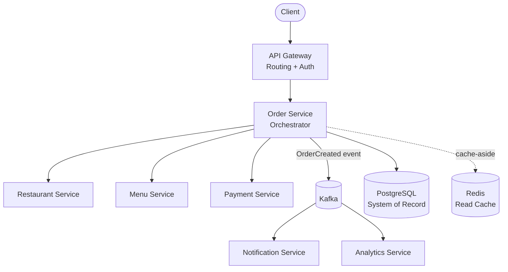

# OrderStream

A production-grade, microservices-based order processing platform for online food ordering, built to demonstrate correctness-first distributed system design under real-world concurrency and failure conditions.

OrderStream is modeled after real-world food ordering systems (e.g., DoorDash, Grubhub) and independently architected end-to-end, from domain decomposition through deployment.

## Why This Project Exists

Order processing systems face a hard reliability problem: a single order touches multiple independent concerns (menu validation, payment, inventory, notifications), and a failure in any one of them can't be allowed to corrupt the state of the others. Most simple implementations either wrap everything in a single monolithic transaction (doesn't scale across services) or use two-phase commit (introduces distributed locks and kills throughput under load).

OrderStream solves this with an orchestration-based Saga pattern instead, prioritizing fault isolation and correctness without sacrificing throughput.

## Architecture



The system is decomposed into five bounded contexts, each owning its own data: **Menu**, **Cart**, **Order**, **Payment**, and **Notification**. This reduces inter-service coupling and lets each service be deployed independently.

## Key Technical Decisions

| Decision | Rationale |
|---|---|
| **Orchestrated Saga over 2PC** | Avoids distributed locks and improves fault isolation; failures trigger compensating actions (e.g., inventory rollback, payment reversal) instead of a global rollback. |
| **Kafka as async event backbone** | Decouples order creation from downstream Notification/Analytics processing, so non-critical work never blocks the user-facing order flow. Consumers are designed to be idempotent. |
| **CompletableFuture for external calls** | Restaurant and Menu service calls are independent, so they're executed in parallel via a dedicated thread pool, reducing latency and isolating thread starvation risk. |
| **PostgreSQL as system of record, Redis as cache-aside only** | A conscious CP-over-AP choice: Redis failures can degrade read performance but can never corrupt order data, since Postgres remains the sole source of truth. |
| **Post-commit event publishing** | Kafka publishing happens via post-commit listeners, not inside the local transaction, so an event is only ever published after the database commit has actually succeeded. |
| **Optimistic locking + idempotency keys** | Used sparingly, only where they protect business correctness (e.g., preventing duplicate orders under concurrent retries), rather than locking broadly. |

## Correctness Guarantees

- **Atomicity**: order creation executes inside a local transaction at the service layer — an order is either fully created or not created at all.
- **Cross-service consistency**: handled via orchestrated Saga with compensating transactions, since local transactions alone can't span services.
- **Idempotent event consumption**: downstream consumers (Analytics, Notification) tolerate at-least-once delivery without side effects from duplicate events.

## Performance

- Supported **500+ concurrent order events** in simulated traffic-spike load testing without degradation.
- Reduced checkout and menu-search query latency by **35%** through targeted indexing and connection pool sizing (identified via AWS RDS performance insights and query execution plans, not guesswork).
- **Zero-downtime deployments** via CI/CD pipeline to AWS App Runner.

## Security

APIs are secured with Spring Security + JWT, implementing Role-Based Access Control (RBAC) across 10,000+ simulated user accounts.

## Testing

Business logic and transactional behavior are tested at the service layer using JUnit and Mockito. External dependencies (Kafka, the database) are mocked in unit tests to keep them fast and deterministic; integration tests separately validate real infrastructure behavior. This split allows the system to be refactored safely while preserving business guarantees.

## Tech Stack

- **Backend**: Java, Spring Boot, Spring Security
- **Messaging**: Apache Kafka
- **Data**: PostgreSQL, Redis
- **Testing**: JUnit, Mockito
- **Infra**: Docker, AWS (RDS, App Runner), CI/CD

## Running Locally

```bash
git clone https://github.com/ZihaoLiuNU/orderstream-v2.git
cd orderstream-v2
docker-compose up --build
```

This spins up the application alongside its PostgreSQL, Redis, and Kafka dependencies via `docker-compose.yml`.

## What I'd Do Differently

- Be more deliberate about Kafka topic and partition design upfront (target QPS/RPS) rather than treating it as an implementation detail to size reactively.
- Push authentication and routing concerns more explicitly and consistently into the API Gateway layer from day one, rather than letting some of that logic drift toward individual services as the system grew.

## Author

Built independently by [Zihao (Jack) Liu](https://github.com/ZihaoLiuNU), leveraging AI-assisted development workflows (Claude Code) to accelerate architectural iteration while retaining full ownership of architecture, code quality, and deployment.
