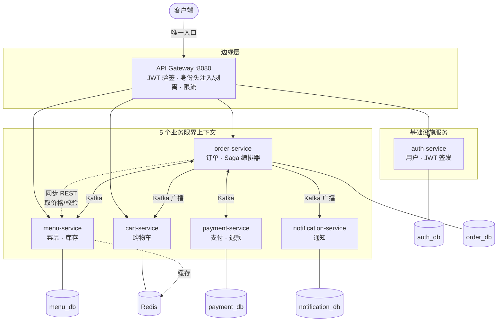

# OrderStream

一个事件驱动的外卖订单平台，用来解决一个具体问题：
**当下单依赖一个可能失败的支付步骤时，如何在不持有分布式锁的前提下保证订单状态正确。**

系统按 DDD 拆成 **5 个业务限界上下文**（Menu / Cart / Order / Payment / Notification），
每个上下文是一个独立部署的服务、拥有自己的数据库，上下文之间只通过 Kafka 事件通信。
跨服务的一致性由**编排式 Saga + 补偿事务**保证。

> 本 README 里的每一项声明都有对应的代码和可复现的验证。
> 压测数据见 [`loadtest/RESULTS.md`](loadtest/RESULTS.md)。

---

## 架构



| 服务 | 角色 | 存储 |
|---|---|---|
| **api-gateway** | 基础设施：路由、JWT 验签、身份头注入与剥离、Redis 令牌桶限流 | 无（无状态） |
| **auth-service** | 基础设施：用户、JWT 签发、refresh token 轮换 | `auth_db` |
| **menu-service** | 业务上下文：菜品目录、库存。Saga 参与者（步骤 1 / 补偿 1） | `menu_db` + Redis 缓存 |
| **cart-service** | 业务上下文：购物车 | Redis（无关系库） |
| **order-service** | 业务上下文：订单聚合 + **Saga 编排器** | `order_db` |
| **payment-service** | 业务上下文：支付、退款。Saga 参与者（步骤 2 / 补偿 2） | `payment_db` |
| **notification-service** | 业务上下文：用户通知。纯事件订阅者 | `notification_db` |

> Gateway 和 Auth 是**横切的基础设施能力**，不是业务限界上下文 ——
> 限界上下文是按**业务语言的边界**划分的，不是按"拆了几个服务"。

---

## 核心：为什么需要 Saga

一次下单要改三个服务的数据：扣库存（`menu_db`）、扣款（`payment_db`）、建订单（`order_db`）。
**三个物理独立的数据库，没有任何本地事务能横跨它们。**

### 为什么不用两阶段提交（2PC）

- 参与者从 prepare 到 commit 期间**一直持锁**，吞吐极低
- 协调者在 prepare 后崩溃，参与者会**无限期持锁**（in-doubt transaction），必须人工介入
- **第三方支付网关根本不提供 prepare/commit 接口** —— 2PC 在真实业务里不可用

### Saga 的做法

把分布式事务拆成一串**本地事务**，每步立刻提交并释放锁；某步失败就按相反顺序执行**补偿事务**。

```
        ┌─ 步骤1 ─────────┐   ┌─ 步骤2 ─────┐   ┌─ 步骤3 ──┐
下单 ──▶│ 预留库存        │──▶│ 扣款        │──▶│ 确认订单 │──▶ COMPLETED
        │ (menu-service)  │   │ (payment)   │   │ (本地)   │
        └─────────────────┘   └─────────────┘   └──────────┘
                 │                    │
            预留失败              支付失败
                 │                    │
                 ▼                    ▼
           订单 CANCELLED    释放库存 ──▶ 订单 CANCELLED
                                        (COMPENSATED)
```

**步骤顺序是设计出来的，不是随便排的**：把**容易补偿**的步骤放前面。

- 释放库存 = 一条本地 UPDATE，瞬间完成，几乎不可能失败
- 退款 = 调第三方网关，慢、可能失败、有手续费、可能 T+1

先付款后扣库存的话，库存不足时就必须退款 —— 用高代价的补偿去处理一个本可避免的失败。

最难补偿的那一步叫 **pivot transaction**（这里是支付）。
Saga 的核心要求是：**pivot 之前的步骤都要可补偿，pivot 之后的步骤都要必定成功**。
本系统里 pivot 之后只剩"更新本地订单状态"，且与"记录支付结果"在**同一个本地事务**里，不存在独立失败的可能。

### 代价：放弃隔离性

Saga 缺的是 ACID 里的 **I**。订单在 `PENDING` 时中间状态对外可见。
本系统用 **`PENDING` 状态本身作为语义锁**（semantic lock）—— 它明确告诉所有读者"这笔还没定"。

---

## 关键技术决策

| 决策 | 理由 | 代码位置 |
|---|---|---|
| **Database per service** | 共用库会得到"分布式单体"：改表会炸别人、会写跨表 JOIN、边界消失。**更关键的是：正因为没有共享库，本地事务无法跨服务，才逼出了 Saga** | `infra/postgres/init-databases.sh` |
| **Transactional Outbox** | 消除 dual-write。业务数据和待发事件写进**同一个数据库、同一个事务**，原子性由本地 ACID 直接保证，不需要分布式事务协调者 | `messaging/outbox/` |
| **消费端幂等（去重表）** | Kafka 是 at-least-once，重复消费是必然。去重标记与业务变更**同事务**提交，达成 effectively-once | `messaging/idempotency/` |
| **边缘认证 + 身份头传递** | 网关验签一次，下游不解析 JWT（否则密钥要分发到 7 个服务，轮换是灾难）。**前提是网关必须剥离客户端伪造的头** | `api-gateway/filter/` |
| **对象级授权在 Service 层** | RBAC 只回答"你这类人能做什么"，回答不了"你能碰哪条数据"。后者是 OWASP API Top 10 第一名（BOLA） | `order/entity/Order.isOwnedBy` |
| **原子条件 UPDATE 扣库存** | `WHERE stock >= ?` 写在 UPDATE 里，一条语句完成"检查+扣减"。比乐观锁更适合计数器场景：无重试风暴 | `menu/repository/MenuItemRepository` |
| **按 ID 排序加锁** | 统一加锁顺序，在结构上杜绝环形等待（死锁四条件之一） | `menu/service/StockService.reserve` |
| **Redis 只做缓存，可降级** | 区分**关键路径依赖**和**优化性依赖**。Redis 挂了系统应该变慢，不是不可用 | `menu/config/RedisCacheConfig` |
| **超时兜底扫描** | 消息协调依赖"对方会来通知我"；基于超时的自愈不依赖任何外部方。两者都要（就像 TCP 的 ACK + 超时重传） | `order/saga/StuckSagaSweeper` |

---

## 实测结果

完整报告见 [`loadtest/RESULTS.md`](loadtest/RESULTS.md)。

### 容量曲线（同步下单接口）

| 并发 | 订单数 | p50 | p95 | p99 | 吞吐 | 错误率 |
|---:|---:|---:|---:|---:|---:|---:|
| 100 | 5,523 | 16.1 ms | 25.5 ms | 37.1 ms | 39.9 /s | 0% |
| 300 | 14,168 | 16.7 ms | 32.4 ms | 59.4 ms | 98.6 /s | 0% |
| **400** | 18,322 | 16.2 ms | **26.1 ms** | 55.2 ms | 119.9 /s | 0% |
| **500** | 22,147 | 35.7 ms | 228.6 ms | 605.0 ms | **144 /s** | **0%** |

- **拐点在 400 并发**：到此为止 p95 稳定在 30ms 内
- **500 并发时开始排队，但错误率仍是 0** —— 这正是想要的降级形态：**变慢，但不失败、不丢数据**
- 异步 Saga 链路吞吐 **约 107 单/秒**，瓶颈是 payment-service（6 消费线程 × 50ms 模拟延迟 = 理论 120/秒）

### 正确性验证（90,136 笔订单累计）

```
订单 90,136 : Saga 90,136 : 支付 90,136 : 库存预留 90,136   ← 精确 1:1:1:1
跨库对账      1,866,713.58 == 1,866,713.58                  ← 分毫不差
库存守恒      50,000,000 == 49,916,955 + 83,045             ← 精确到个位
Saga 卡死 0 · 事件积压 0 · 重复扣款 0 · 超卖 0 · 死信 0
                                              15 / 15 通过
```

补偿率 9%，与配置的 10% 模拟支付失败率吻合 —— 说明**补偿路径在高并发下被真实执行了 8,973 次并且全部正确**。

---

## 压测中发现并修复的真实问题

> 这一节比上面的数字更有价值 —— 这些问题**只有真正跑起来才会暴露**。

1. **Outbox relay 是吞吐瓶颈**（30 → 1,400 条/秒，提升 40 倍）
   逐条 `send().get()` 把 100 条消息变成 100 次串行网络往返。
   改成整批发出后统一等待 ack —— **消除串行等待，但不取消等待**，可靠性保证不变。

2. **`@Scheduled` 默认只有 1 个线程**
   兜底扫描器单次执行 3 分半，期间 Outbox relay **一次都没被调度**。
   表现像"Outbox 坏了"，实际是"Outbox 没机会运行"。

3. **事务里 catch 异常是无效的**
   Spring 已把事务标记为 rollback-only，后续循环全是白干。
   要让"一条失败不影响其他条"必须各自独立事务 —— 而这又踩到 **AOP 自调用**陷阱。

4. **Alpine 的 musl libc 与 snappy 原生库不兼容**
   这次c故意外成了一场真实的故障演练：消息通道中断 20 分钟、单条事件重试 309 次，
   修复后 **Outbox 自动补发，零数据丢失**。

---

## 技术栈

Java 21（虚拟线程）· Spring Boot 3.2 · Spring Cloud Gateway（响应式）· Spring Security
Apache Kafka 3.7（KRaft，无 ZooKeeper）· PostgreSQL 16 · Redis 7 · Flyway
Resilience4j（熔断）· Micrometer / Prometheus · JUnit 5 + Mockito · k6 · Docker Compose

---

## 快速开始

```bash
cp .env.example .env
# 生成密钥： openssl rand -base64 48  填入 JWT_SECRET

docker compose up -d --build       # 10 个容器
bash loadtest/smoke-test.sh        # 16 项端到端验证
```

只起基础设施（应用在 IDE 里跑，方便调试）：

```bash
docker compose up -d postgres redis kafka
```

各服务本地端口：gateway 8080 · auth 8081 · menu 8082 · cart 8083 · order 8084 · payment 8085 · notification 8086

---

## 已知局限与后续工作

> 明确写出来，因为知道边界在哪比假装没有边界更重要。

| 项 | 现状 | 生产环境应该怎么做 |
|---|---|---|
| JWT 签名 | HS256 对称，网关和 auth 共享密钥 | RS256 + JWKS 端点，让网关只持公钥 |
| 服务间调用 | 靠网络隔离（下游不暴露端口） | service mesh 的 mTLS，零信任 |
| access token 撤销 | 做不到，靠 15 分钟 TTL 限制损失窗口 | 若业务要求即时撤销，需 Redis 黑名单（牺牲无状态） |
| Kafka 副本 | 单 broker 1 副本 | 3 副本 + `min.insync.replicas=2` |
| Outbox 投递延迟 | 轮询 200ms | Debezium CDC 直读 WAL，消除轮询延迟 |
| 定时任务多实例 | `@Scheduled` 每个实例各跑各的（当前任务幂等所以无害） | ShedLock 分布式锁，或交给 K8s CronJob |
| `messaging` 模块粒度 | outbox 与 idempotency 捆在一起，cart-service 因此无法复用 Kafka 配置 | 拆成 messaging-kafka / -outbox / -idempotency 三个模块 |
| 故障注入测试 | 未做 | 用 Toxiproxy / Chaos Mesh 主动注入网络分区和服务宕机 |

---

## 关于 AI 辅助开发

本项目大量使用 Claude Code 生成代码。我负责的是**架构决策、代码审查、以及发现它写错的地方**。

审查中发现并修复的问题包括：Outbox 事件在事务提交前发出（dual-write）、
`getOrderById` 缺少对象级授权（BOLA）、Kafka 消费者非幂等导致订单状态倒退、
`@Bean List<NewTopic>` 不被 KafkaAdmin 识别导致 topic 静默不创建。

**AI 让写代码变快之后，瓶颈就从"写"转移到了"知道该检查什么"。**
这个项目里最有价值的部分不是那些跑通的代码，而是上面那份"压测中发现的问题"清单。
